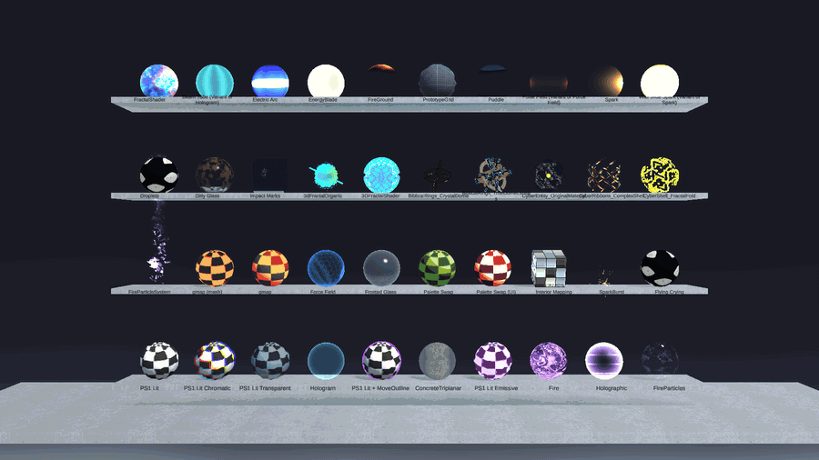

# Shader Gallery

Shaders from my Unity projects, collected in one scene so I can compare them, adjust
their materials and record them without opening each game.

Recorded with the gallery's built-in GIF recorder.

Most shaders sit on spheres, some use cubes, and UI shaders get flat panels. Particle
effects sit alongside them. Each exhibit has a label and a close-up button in the
inspector.

Unity 6000.0.32f1, URP 17.0.3. Open `Assets/Scenes/ShaderGallery.unity` and select
**Gallery Rig**, the panel is in the inspector.

## Adding a shader

Put the file in `Assets/Shaders/Local/`, then **Shader Gallery → Shader List**, Rescan,
tick it, Apply. The gallery creates a material, a display object and a label, then
rearranges the shelves. Shaders that need custom geometry or scripts still need those
set up separately.

Ten per shelf, split evenly, so eleven shaders sit as 6+5 and twenty as 10+10. You can
set the number yourself in the panel.

## Where the shaders come from

`Assets/Shaders/Shared/` is a copy of my [unity-shaders](https://github.com/xehster/unity-shaders)
repo, brought in by a scheduled GitHub Action. Don't edit it, the next sync overwrites the
whole folder. To change one of those shaders, copy it to `Local/` without its `.meta` and
rename the shader on the first line. The copy is then yours and nothing overwrites it.

The sync leaves `Local/` alone. New shared shaders appear in the list after Rescan;
tick the ones you want and Apply to add them to the scene.

## 2D shaders

UI shaders don't work on a sphere, so they get a flat panel. A camera off to the side
renders a reference sphere into a texture, and that's the picture the shader recolours,
live. Swap it for your own art in **Sample Texture** on the rig.

The list guesses 2D from the stencil and colour mask properties that UI-Default shaders
carry. The **3D / 2D** button next to the tick overrules the guess.

## Recording

On **Gallery Rig**, open **Recording** to choose the frame rate and output width.
**Record the gallery** writes `docs/gallery.gif`, the file shown above. Use **Wide shot**
first for the full gallery. Pick a close-up and use the second record button to save
that exhibit to its own GIF in `docs/`.

Frames are rendered at fixed time steps and encoded with ffmpeg. A recording lasts one
bounce cycle, one full spin, or two seconds in Still mode. Shader animations and
particles can have their own timing, so they may not loop at the same point.

Needs ffmpeg on PATH, or installed with `winget install Gyan.FFmpeg`.

## The panel

**Spin / Bounce / Still** is how the row moves. Everything animates in Edit Mode, no need
to enter play, and particle systems are stepped by hand for the same reason.

**Close-up** flies the camera to one subject and hides the others. **Labels** turns the
text off for a clean recording.

**Shader settings** holds a foldout per material, drawn by Unity's own material inspector,
so a new shader brings its settings with it.

**Renderer features** toggles the full-screen passes on the URP renderer. Those are
project-wide, put them back when you're done.

## Notes

Some textures are web placeholders, there so things render on import: the concrete maps in
`Assets/Textures/Concrete/` and the two `placeholder_*` files by the particle system. Not
mine to license, swap them before shipping anything.
